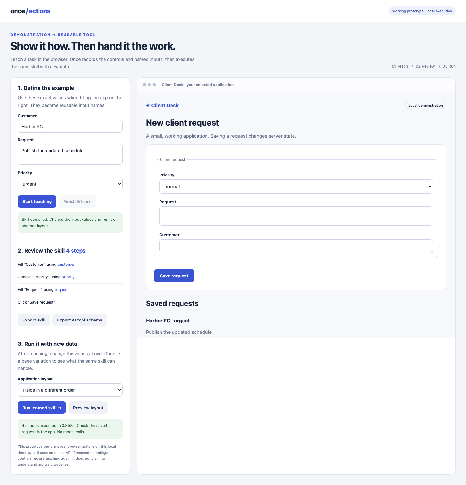

# Once Actions

**Teach a browser task. Give an agent a tool that performs it.**

Once Actions is a working local prototype of demonstration-to-tool compilation. Fill a form once, bind its values to named inputs, review the recorded actions, then replay with different data. A saved skill can also run through an MCP client.



## Try it

Requires Python 3.10+ and Chromium installed through Playwright. No model API key or paid service is needed.

```sh
python -m venv .venv
source .venv/bin/activate
pip install -e '.[mcp,dev]'
python -m playwright install chromium
once-actions studio
```

Open **http://127.0.0.1:8780**. Use the IP address shown; the server rejects other Host headers.

1. Click **Start teaching**. In the app, enter the three example values shown on the left and save the request. Teaching performs a real write to the demo's in-memory server.
2. Click **Finish & learn**. Review the four actions and export the skill.
3. Change the input values and select **Fields in a different order**. Run the learned skill. The new record appears in the application.
4. Select **Two matching Save buttons** and run again. Execution pauses before choosing either button. No new request is saved in this example.
5. To handle **Customer label renamed**, preview that layout and teach again using its new label.

The included Client Desk app is owned test software, not a third-party integration. The studio currently teaches this one form. The executor and MCP bridge accept the same data-only skill format against a fixed loopback application URL.

## Connect a saved skill to an agent

Export `create_client_request.skill.json` from the studio. Leave the studio running. Configure an MCP host to launch this command with absolute paths:

```sh
/absolute/path/to/.venv/bin/once-actions mcp \
  /absolute/path/to/create_client_request.skill.json \
  --url http://127.0.0.1:8780/app
```

This exposes one tool, `create_client_request`, with string inputs `customer`, `request`, and `priority`. The URL and skill are fixed at server startup; the caller cannot supply another URL or a replacement skill. Calls execute real Chromium actions. Host-side permissions still matter: these calls can write data. There is no automatic retry, rollback, or exactly-once guarantee. After a timeout or partial execution, inspect application state before calling again.

The MCP adapter uses the [official Python SDK](https://github.com/modelcontextprotocol/python-sdk). Its acceptance test launches a separate MCP server, discovers the tool, calls it through the SDK client, and checks the resulting application record. **This verifies tool integration; it does not measure a language model choosing or using the tool.**

You can also run without MCP:

```sh
once-actions run create_client_request.skill.json \
  --parameters new-request.json --url http://127.0.0.1:8780/app
once-actions tool create_client_request.skill.json
```

`new-request.json`:

```json
{"customer": "Harbor FC", "request": "Publish the updated schedule", "priority": "normal"}
```

## How it works

The recorder observes field changes and button clicks. It describes targets by accessible role, exact accessible name, and fieldset name when available. Each demonstrated value must match exactly one named example input. The compiler replaces that value with its parameter name and rejects literal values or executable code in the plan.

The runner opens a fresh browser context and resolves these semantic targets. Element IDs, coordinates, and field positions are not part of the skill. It requires exactly one visible target; a missing or ambiguous target pauses execution. It does not silently ask a model to guess. A hash detects edits to the exported plan; it is not a signature or proof of trust.

The return value distinguishes **actions executed** from application success. In tests we separately inspect server state to verify the correct write. Generic postcondition verification is not implemented.

## What is established

- A real browser demonstration compiles into a reusable four-step skill.
- That skill writes the exact new values with new element IDs, reordered fields, and a two-column layout.
- Missing labels and duplicate Save targets stop the tested workflow before submission.
- Teaching again handles the renamed field.
- The full studio flow, JSON download, mobile layout, and real MCP transport are exercised automatically.

Run the checks yourself:

```sh
ruff check .
ruff format --check .
python -m unittest discover -v
python -m build
```

These are controlled acceptance cases, not a benchmark of arbitrary websites. See [design and limits](docs/design.md) for the trust boundaries and [the next experiment](docs/next-experiment.md) for the evidence needed before expanding the project.

## Scope

This first release supports text fields, native selects, and buttons on a trusted local app. It does not support authentication, arbitrary internet sites, browser extensions, conditional workflows, automatic repairs, or model-driven planning. Demo records and the active studio skill live in memory and disappear when the server stops; export skills you want to keep.

Browser workflow recording already exists in projects such as [workflow-use](https://github.com/browser-use/workflow-use) and products such as [Skyvern](https://www.skyvern.com/products). This project does not claim to invent it. The proposed direction is a small, reviewable tool learned from demonstration, with user correction when meaning changes. Whether that offers a useful advantage remains to be tested.

MIT licensed.
