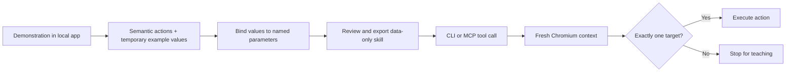

# Design and boundaries

## Data flow

The tool caller supplies strings. It cannot change the target application, select arbitrary JavaScript, or add actions. The local operator chooses the skill and URL before starting the MCP process. Parameters are validated again inside the executor, not only advertised in a schema.

## Why semantic targets

Accessible labels and fieldset names survive some structural changes that invalidate element IDs or positional selectors. They do not establish semantic equivalence. Two controls can have the same name but different meaning; a unique matching control can also have changed meaning. Therefore matching one target is a prerequisite for execution, not proof that the action is safe.

The recorder's label extraction covers the included native controls. It is not a complete implementation of the browser's accessible-name algorithm. Unsupported widgets, dynamic labels, shadow roots, frames, and custom controls need separate work and tests.

## Trust and privacy

- Only literal loopback HTTP URLs with explicit ports are accepted. Normal browser HTTP requests to another origin are blocked; service workers are disabled and WebSockets are closed. This is a test constraint, **not an OS network sandbox**. Use trusted local pages only.
- The studio binds to `127.0.0.1`. It checks Host and browser Origin headers and requires JSON for writes. Local processes can still call it. It has no authentication and is not an internet service.
- Demonstrated field values pass through JavaScript memory to bind names. The saved plan contains parameter names instead of these values. Target labels can still contain page content; exports are not universally redacted. Inspect an export before sharing it.
- During execution, the supplied values necessarily reach the target app. The demo keeps its records in memory and displays them. MCP hosts may separately log tool arguments.
- The plan is validated and hashed, but the hash is neither a signature nor an authorization mechanism. Anyone can recompute it. Review imported plans.
- The recorder trusts its owned application. Same-origin scripts can forge capture events; this prototype does not record hostile websites.

## Partial execution

The runner does not retry automatically. Earlier actions may already have changed state when a later action fails. `needs_teaching` and `blocked` do not mean nothing happened. A click returning successfully also does not prove the application committed a change. Cancellation does not roll back a running browser task.

The MCP process admits one execution at a time. The worker holds the lock through completion, including after a client cancels its wait. Separate MCP processes are not coordinated. The studio has its own single-run lock. None of these provide transactionality or duplicate prevention.

In the included ambiguous-button test, preceding steps only fill fields, so stopping before Save prevents a write. Do not generalize that observation to multi-write workflows.

## Deliberate first-slice constraints

One native form, one ordered sequence, string inputs, no account sessions, no inference. There is no learned generalization beyond the matching rules, no hidden model fallback, and no cost or success-rate comparison with other automation tools. The suite validates the mechanics needed for a broader experiment; it does not establish production readiness.
