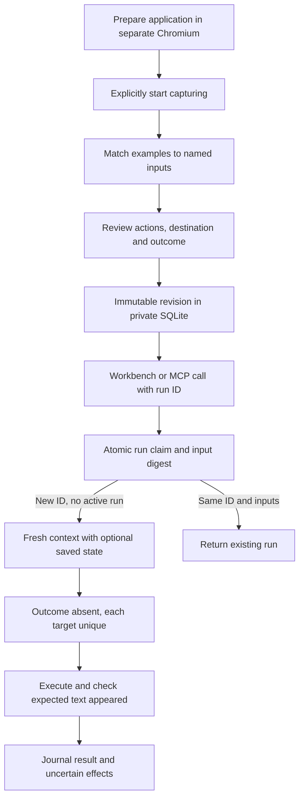

# Design and boundaries

## Requirements and architecture

A person prepares a trusted application, demonstrates a native-control task, reviews its named inputs and actions, and saves it. Replaying uses new inputs and a fixed destination. The library and run history survive restarts. Changed targets require an explicit reviewed revision. An MCP host can call the same revision through the same journal. Errors preserve uncertainty about earlier effects.

This is a personal local macOS/Linux application. It is not a hosted service, a general web agent or a hostile-page sandbox. Supported applications must work with one origin, native controls and the documented storage restrictions.

The HTTP server owns the library lease, recorder and execution threads. Each worker owns its Playwright connection and browser. The UI sends control requests with a per-process token. `mcp-live` connects to that server and pins one reviewed revision. It exposes named string inputs and a caller-generated run UUID, not arbitrary navigation, JavaScript or selectors. Legacy file CLI/MCP commands remain available without the persistent library or journal.

## Persistent contracts

- `skills` identifies a workflow; `revisions` holds immutable validated plans. Corrections require the expected latest revision in a transaction and change one target only.
- V2 plans fix the URL, ordered actions, parameters and exact visible-text outcome. The canonical hash detects edits; it is not a signature or authorization mechanism.
- `runs` holds UUID, revision, keyed digest of inputs and result. Raw inputs are not journaled. Reusing an ID with changed inputs or revision is rejected. Concurrent identical calls get one execution claim; distinct overlapping runs are rejected.
- Optional `browser_states` holds cookies and local storage per workflow. It may contain credentials or application data. It is separate from exported plans and updated after runs. Session storage, IndexedDB and JavaScript memory are not preserved.
- SQLite transactions and a process lease coordinate one library. Database format version 1 rejects unknown newer formats. Startup marks unfinished runs interrupted without replaying them.

The browser and destination cannot participate in the SQLite transaction. A crash after the application changes but before the journal commits leaves an uncertain result. Run identity prevents replay of that same local request; it does **not** promise exactly-once remote effects, coordinate different libraries, or prevent an operator from choosing a new ID. There are no automatic retries or rollback. A failed journal write exposes `storage_failed` and blocks new runs until restart; inspect application state first.

## Recording and execution

Setup actions are discarded until Start capturing. The current same-origin URL then becomes the fixed start URL. Entered values must match distinct named examples exactly. Actions store parameter names instead of examples. Target labels and outcome text can contain page content, so exports still need review.

Recording handles labelled native inputs, textareas, selects, checkboxes, buttons, links, placeholders and Enter. Fieldset labels can disambiguate groups. Label extraction is not the complete accessible-name algorithm. Frames, shadow-root/custom widgets and popups are outside the tested recording contract.

The runner requires one visible exact target. Missing or ambiguous targets stop execution. A unique match does not establish semantic equivalence: a control may have changed meaning. Corrections are reviewed label/group edits, not autonomous repair or learning from a corrected demonstration.

For v2, the declared outcome must be absent before actions and uniquely visible afterwards. A visible message is an observation, not proof of durable transaction commit. Even filling a field can autosave, so `effects_possible` becomes true before attempting any action. Cancellation is cooperative between actions. Browser operations have finite timeouts; the two-minute deadline is checked between steps, not a hard real-time limit.

## Trust and privacy

- The server binds to literal `127.0.0.1`, checks Host and browser Origin, requires JSON and a token for control writes, and emits CSP/frame protections. No CORS access is granted. It is not authenticated against another same-user process. Do not expose it through a proxy or public tunnel.
- V2 supports HTTPS and explicit-port literal loopback HTTP. Normal browser requests are limited to the chosen origin; service workers are disabled and WebSockets closed. This is **not an OS network sandbox**. Trusted application scripts may forge capture events or send data to their origin. The workbench itself cannot be an automation target except its owned practice page.
- Created library directories use mode 0700; database and lock files use 0600. Saved state is not encrypted. Backups include it and the digest key. Forgetting state does not revoke server-side sessions or guarantee forensic erasure.
- Supplied inputs necessarily reach the application. MCP hosts may log them independently. Once Actions does not call a model, send telemetry or upload a library.

## Tradeoffs and evidence

SQLite and separate browser contexts simplify installation and recovery, at the cost of one active run and limited session compatibility. Strict origin/target rules stop rather than guess, reducing compatibility with multi-origin applications. Deterministic plans avoid model calls but cannot infer unrecorded tasks or adapt autonomously.

[Validation](validation.md) separates our own practice app from unmodified TodoMVC and sqlite-web. Those checks support the implemented path, not broad compatibility, comparative maintenance savings, adoption or novel research. [Operations](operations.md) covers installation, recovery and backup.
